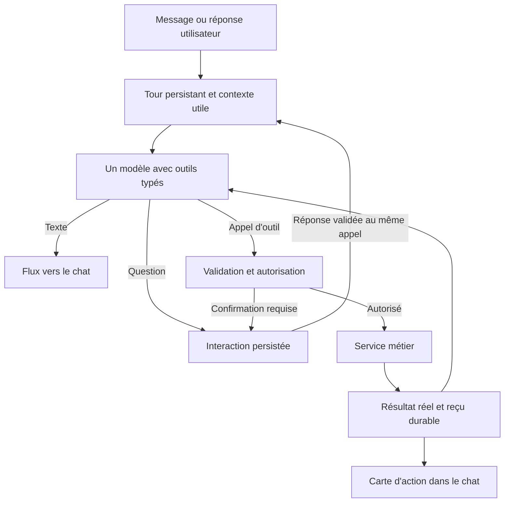

# Architecture recommandée pour Planner

Recherche du 26 novembre 2026. Décision proposée, pas architecture déjà implémentée ou mesurée.

## Décision

Je recommande de réécrire le moteur conversationnel de Planner autour d'une seule boucle de modèle outillée, avec des effets métier contrôlés et un état d'exécution persistant. Il faut remplacer le système qui interprète, reprend et rend les tours, plutôt que continuer à lui ajouter des exceptions.

La cible technique à éprouver en premier est **Django + PostgreSQL pour le métier, PydanticAI pour la boucle modèle/outils, DBOS pour la reprise durable, SSE pour l'interface**. Un seul framework agent, un seul moteur de durabilité. Ni LangGraph ni un groupe d'agents supplémentaires dans cette proposition.

La conservation de Django n'est pas motivée par le travail déjà investi : les causes observées se concentrent dans l'orchestration, le contexte, les contrats d'outils et le rendu. Réécrire les comptes, le stockage des documents, les notifications iOS et les écrans ne corrigerait pas ces causes. Les services métier sont à conserver après vérification de leurs contrats, pas à déclarer corrects par défaut.

L'architecture est une recommandation argumentée. Le choix de DBOS et du réglage modèle reste conditionné à un prototype exécuté avec les versions réellement retenues. Aucun gain chiffré du nouveau système n'est encore démontré.

## Ce qui a été vérifié

Code lu sur `origin/main` au commit `69700e4b9defc86a33ee01e690b89a8b32922291`, et sur la PR 41 au commit `4af4b91a18cbb31a27551f4397947dca0f562309`. Les mesures de production sont celles du [diagnostic du 26 novembre](diagnostic-latence-agent-2026-11-26.md), pas un nouveau benchmark exécuté pour cette recherche.

| Constat | Preuve | Conséquence |
| --- | --- | --- |
| Six tours observés durent 32,56 à 93,55 secondes, avec 4 à 8 requêtes modèle; quatre expirent à 60 secondes | Diagnostic, traces et métadonnées examinées lors du travail précédent | Réduire les appels et tester le réglage du modèle compte davantage que gagner quelques millisecondes de code |
| Jev prend environ 69 à 118 ms et les outils observés restent sous 151 ms dans cet échantillon | Même diagnostic | Retirer Jev ne suffit pas à expliquer ni résoudre toute la lenteur |
| Le module agent reçoit directement le message, sans décideur systématique avant la boucle | `services/agent_v2/conversation.py:57` | Ne pas recommander de supprimer un pré-routeur déjà absent du chemin principal |
| Des gardes interprètent encore le texte, les titres, les heures et leurs relations | `outils.py:1304`, `outils.py:1515`, appels depuis `_executer_appel` | La compréhension reste répartie entre le modèle et une interprétation partielle du français par le code |
| Le backend choisit encore une question après la boucle et assemble plusieurs sources de réponse | `agent.py:1797`, `redaction.py`, `mesure.py` | Plusieurs composants peuvent remplacer la décision ou le message du modèle |
| Le texte du modèle n'est pas transmis au fil de sa production; le handler ne relaie que les parties de raisonnement | `agent.py:480` puis composition et événements `delta` | Le streaming fournisseur ne devient pas un streaming immédiat de réponse |
| L'historique modèle est reconstruit depuis des messages utilisateur/assistant et leurs textes, pas depuis le protocole complet des outils | `agent.py:2029` | Les résultats et interactions doivent être reconstitués; la PR 41 réduit cette perte sans supprimer la reconstruction |
| `ChatTurn` protège l'admission HTTP et conserve le résultat terminal; un tour interrompu n'est volontairement pas repris automatiquement | `core/models.py:930`, `core/chat_turns.py` | Une coupure client est mieux couverte qu'une mort du processus au milieu des actions |
| L'idempotence d'outil utilise notamment un cache en mémoire du tour et des contrôles de rapprochement | `outils.py:2355`, `registre.py` | Ce mécanisme ne remplace pas un reçu durable enregistré atomiquement avec l'effet |
| Le prompt commence par le nom, la date à la minute et des données variables, avant ses grandes règles stables | `prompts.py:321` | Le long préfixe stable n'est pas optimisé pour le cache; le taux de cache doit être mesuré |
| La boucle ne fournit pas de réglage explicite de l'effort de raisonnement | `agent.py:535`, `modeles.py:70` | Le défaut du fournisseur peut être inadapté à une interaction simple |

Inventaire statique exécuté sur la PR : 28 modules Python et 15 262 lignes dans `services/agent_v2`, dont 3 263 dans `outils.py`, 2 095 dans `agent.py` et 2 083 dans `rendu.py`. Ce compte inclut commentaires et chemins hérités. Il mesure la surface à comprendre, pas la lenteur ni le nombre de lignes réellement exécutées. `REGLES_AGIR` compte 10 696 caractères, avant les descriptions d'outils et les données du compte.

Plusieurs commentaires décrivent encore une sortie JSON ou une phase de rédaction séparée qui ne correspondent plus exactement à la boucle actuelle. Une nouvelle implémentation doit avoir une seule spécification du contrat, vérifiée par les tests, plutôt que reprendre ces commentaires comme vérité.

## Pourquoi cette direction

La recommandation d'Anthropic est de commencer par le système le plus simple qui remplit la tâche, puis de justifier chaque ajout par des évaluations. Ses guides sur les outils et le contexte insistent sur des responsabilités lisibles, des résultats utiles, des descriptions non ambiguës et un contexte sélectionné. Cela soutient une boucle unique équipée de bons outils; cela ne démontre pas une performance particulière pour Planner. Sources : [agents](https://www.anthropic.com/research/building-effective-agents), [outils](https://www.anthropic.com/research/writing-tools-for-agents), [contexte](https://www.anthropic.com/research/effective-context-engineering-for-ai-agents).

OpenCode fournit un précédent utile pour les messages par parties, les événements de texte, les outils, les questions et les permissions. Son code actuel a été lu au SHA `bcd14570020e0619aaf450bbe974898e12cadebb`. Son mécanisme de formulaire utilise toutefois une attente en mémoire : persister la session n'implique pas que toute attente humaine survive à un redémarrage. Il ne faut donc pas copier son runtime complet dans un service Planner utilisé sur téléphone. Le [rapport des sources](recherche-architecture-sources-2026-11-26.md) fournit les fichiers et limites exacts.

PydanticAI propose déjà des résultats d'outils différés et des flux d'événements sans arrêter toute la boucle au premier morceau de texte. Les symboles concernés ont été vérifiés dans la version 1.30.1 installée. Le SDK n'impose donc pas notre rétention actuelle du texte. Ses exemples actuels de durabilité ne prouvent pas la compatibilité de toutes leurs dépendances avec les versions de Planner. Sources : [outils différés](https://ai.pydantic.dev/deferred-tools/), [agents et événements](https://ai.pydantic.dev/agents/).

## Contrat de la nouvelle boucle



Le modèle comprend, choisit ses outils, demande une précision et explique leurs résultats. Le serveur possède les autorisations, la portée autorisée, l'exécution, les limites de coût et les preuves d'effet. L'interface affiche les événements. Aucun de ces composants ne doit réinterpréter silencieusement le texte produit par un autre.

Une conversation simple vise une requête modèle. Une lecture avec réponse ou une écriture entièrement spécifiée vise souvent deux requêtes : appel d'outil, puis réponse fondée sur le résultat. Résoudre une cible ou un conflit peut demander davantage. Ce sont des objectifs de conception, pas des limites qui interrompent une tâche valide après un nombre arbitraire d'appels.

Les lectures indépendantes peuvent se grouper. Les écritures sur une même ressource sont sérialisées ou protégées par une version attendue. Une demande de réorganisation importante dispose d'un outil métier qui calcule un plan et ses conflits, puis d'une application autorisée de ce plan. Elle ne demande pas au modèle d'inventer et de tester chaque créneau un par un. Ce plan explicite reste réservé aux opérations qui en ont besoin.

## Des outils qui transmettent une issue exploitable

Le contrat existant `ToolResult` possède déjà des issues distinctes. Il faut conserver ce travail et en faire le contrat unique, avec identifiant d'opération et reçu durable. Exemple indicatif :

```json
{
  "tool_call_id": "call_123",
  "operation_id": "op_456",
  "status": "completed",
  "data": {"task_id": 42, "deadline": null},
  "receipt": {"effect": "task_created", "resource_version": 1},
  "error": null
}
```

Les issues couvrent notamment terminé, partiel, inchangé, information manquante, confirmation attendue, conflit, indisponibilité et effet inconnu. Une erreur précise le champ ou la condition en cause, les éléments concernés et si une nouvelle tentative est admissible. Une valeur absente reste absente. Une liste tronquée porte son indicateur et un moyen de lire la suite.

Un schéma vérifie un format; il ne prouve pas la compréhension. Le serveur valide une heure structurée, une date, un fuseau, une cible appartenant au compte ou une portée de récurrence. Il ne reconstruit pas l'intention en rapprochant des mots de la phrase utilisateur. Les ambiguïtés restantes reviennent au modèle, qui appelle `ask_question_custom`.

Les outils courants gardent des schémas complets, y compris les contraintes des champs imbriqués. Un catalogue rare peut être chargé à la demande, mais une recherche ne doit pas remplacer le schéma par une chaîne de noms et de types, puis invoquer un outil générique aux paramètres non typés. Il faut mesurer le compromis catalogue initial contre aller-retour de découverte. Il n'existe pas un nombre optimal universel d'outils.

Les skills contiennent les conventions longues, comme les récurrences et la différence entre tâche et rappel. Le catalogue de skills est court, leur contenu est chargé si nécessaire. Les permissions et les préconditions d'exécution restent du code; elles ne dépendent pas du chargement d'un skill.

## Questions et confirmations : une vraie suspension

Une clarification et une autorisation sont deux interactions distinctes, même si elles partagent un composant visuel.

Pour une clarification, conserver `interaction_id`, `run_id`, `tool_call_id`, la question, son schéma de réponse, son état et la demande source. Le clic ou le texte de réponse est validé contre cette interaction et devient le résultat de ce même appel d'outil. Il ne devient pas un nouveau message opaque dont l'agent doit deviner le lien.

Pour une confirmation, le serveur conserve aussi le compte, l'action préparée, les identifiants et versions des cibles, la portée, l'expiration et l'empreinte des arguments. L'utilisateur approuve cette opération précise. Le modèle peut expliquer l'action, mais ne peut pas fabriquer la preuve du consentement. Une cible modifiée impose une nouvelle vérification, éventuellement une nouvelle confirmation.

L'attente survit à la fermeture du chat et au redémarrage du worker. La requête HTTP se termine; aucun thread n'attend l'utilisateur pendant des heures. Un refus devient un résultat explicite retourné au modèle. Il n'autorise ni une action équivalente déguisée ni l'abandon automatique des autres actions indépendantes.

## Persistance et reprise : DBOS comme premier candidat

DBOS possède des intégrations documentées avec Django et PydanticAI. Il apporte la reprise du workflow et des étapes enregistrées, ce qui évite de réimplémenter ordonnanceur, attentes et reprise de processus dans notre chat. Sources : [Django](https://docs.dbos.dev/integrations/django), [workflow](https://docs.dbos.dev/python/tutorials/workflow-tutorial), [PydanticAI](https://ai.pydantic.dev/durable_execution/dbos/).

Cela ne dispense pas des protections métier. Une étape dont le résultat n'a pas été enregistré peut être réexécutée. Les garanties des transactions suivies par les datasources DBOS ne s'appliquent pas automatiquement à un `transaction.atomic()` Django ni à une notification externe. Source : [transactions DBOS](https://docs.dbos.dev/python/tutorials/transaction-tutorial).

Pour les écritures Django, fixer `operation_id` dans l'appel durable avant le premier effet, ou le dériver d'un `tool_call_id` déjà persisté. Ne jamais régénérer cette identité lors d'un replay. Enregistrer ensuite la mutation et son reçu dans la même transaction, avec unicité et contrôle de version. Si une reprise rencontre ce reçu, elle retourne le résultat existant. Une nouvelle demande volontaire garde une identité nouvelle : il ne faut pas dédupliquer toutes les créations identiques pour toujours.

Pour les effets externes, utiliser une boîte d'envoi transactionnelle et la clé d'idempotence du fournisseur lorsqu'elle existe. Si l'issue est inconnue, réconcilier; ne pas prétendre garantir une livraison exactement une fois. Un rappel enregistré, une notification acceptée par APNs et une notification affichée par iOS sont trois faits distincts.

Le journal applicatif garde les événements utiles au client, leur ordre et les identités de ressources. DBOS conserve l'état de reprise; la base métier conserve l'effet. Ce ne sont pas deux moteurs concurrents. Les interruptions, annulations et expirations doivent avoir des états explicites, pas un retour global « je n'ai pas compris ».

Le test décisif est un crash **après le commit métier mais avant l'acquittement de l'étape**, puis redémarrage, retour du reçu et poursuite sans doublon. Les handlers de flux et outils personnalisés demandent un traitement explicite : ajouter DBOS autour d'une fonction ne rend pas tous ses effets automatiquement sûrs.

## Streaming : choisir honnêtement le contrat produit

Il faut distinguer le texte du modèle, l'avancement des outils et les preuves d'action. Les statuts et cartes de résultat réels sont transmis immédiatement. Le texte de conversation et d'explication est streamé dès que le modèle le produit. L'interface reçoit des événements typés, ordonnés et rejouables, puis un événement terminal.

Sur une reconnexion, elle reprend à partir du dernier numéro d'événement reçu. Un fragment n'est pas affiché deux fois. Les cartes peuvent être reconstruites depuis les reçus et dédupliquées par identifiant et version. Les fragments texte sont regroupés en événements, pas écrits en SQL token par token. Les handlers SSE ne deviennent pas durables automatiquement avec DBOS : ce contrat doit être implémenté et testé. Une génération interrompue reste marquée comme interrompue; un fournisseur de secours ne concatène pas sa réponse à une moitié de phrase incompatible. La reprise réutilise les résultats des outils déjà exécutés.

Je recommande de **retirer le juge de prose obligatoire de chaque réponse du chemin normal**. Il sert à l'évaluation hors ligne et, si une mesure le justifie, à un contrôle ciblé avant publication sur une opération à risque. Cela évite d'attendre une phrase complète, de la juger, puis de la faire éventuellement régénérer pour chaque effet simple.

Ce choix a un coût réel : une prose libre déjà affichée peut contenir une erreur. Une carte vérifiée ne garantit pas que la phrase voisine est vraie. Aucun prompt ni juge probabiliste n'apporte une garantie générale d'absence d'hallucination.

Si le produit exige que toute affirmation d'effet visible soit garantie par construction, ces affirmations doivent être rendues depuis des faits structurés contrôlés, ou passer par une politique de publication plus restrictive. Une revue sémantique avec rétention peut réduire le risque, mais reste probabiliste. On ne peut pas promettre simultanément prose totalement libre en direct, veto global avant publication et absence totale d'erreur. **Le passage au streaming libre est une décision produit à valider avant la mise en production, pas une propriété déjà garantie.**

La PR 41 est une stabilisation utile de l'existant. Son contrôle sémantique des réponses après mutation n'est pas la cible à généraliser dans la refonte. Le coût observé de Jev est faible; le vrai risque de ce contrôle est aussi l'appel modèle supplémentaire qu'un rejet déclenche et le maintien d'un rendu concurrent.

## Contexte, cache et modèle

Ordre cible : instructions stables courtes, schémas stables des outils, préférences durables, historique utile et état de l'interaction, puis message courant et données variables datées. Lire les objets métier nécessaires au lieu d'injecter à chaque salutation une semaine, des tâches et des objectifs. L'horloge et le fuseau restent explicites.

Le journal complet n'est pas le prompt. Le contexte garde les messages récents pertinents, les résultats associés à la demande active et un résumé versionné seulement lorsque nécessaire. La compaction préserve les cibles, corrections, refus et interactions en attente avec leur provenance. Une ancienne proposition de l'assistant ne devient jamais un fait extérieur. Le protocole du fournisseur, notamment les parties qu'il exige pour poursuivre les appels d'outils, doit être préservé par l'adaptateur.

DeepSeek documente un cache de préfixe activé par défaut. Le placement des instructions stables favorise sa réutilisation, mais un cache favorable ne supprime ni le volume du contexte ni les tokens générés. Mesurer séparément entrée totale, entrée en cache, sortie, coût, appels non mesurés et temps jusqu'au premier contenu utile. Source : [cache DeepSeek](https://api-docs.deepseek.com/guides/kv_cache/).

La documentation actuelle indique un raisonnement activé par défaut avec effort élevé. Le code de Planner ne le règle pas dans la boucle principale. C'est une hypothèse importante à éprouver, pas la preuve que tout vient de ce défaut. Comparer le même fournisseur en mode actuel, faible effort et sans raisonnement, puis un second modèle candidat sur les mêmes cas. Les appels d'outils restent disponibles selon les capacités documentées; les paramètres forcés ne sont pas identiques entre modes. Sources : [raisonnement](https://api-docs.deepseek.com/guides/thinking_mode/), [appels d'outils](https://api-docs.deepseek.com/guides/tool_calls/).

Choisir un réglage courant qui réussit les tâches ordinaires et un chemin explicite de planification difficile si les évaluations le rendent utile. Ne pas ajouter un nouveau routeur sémantique payant devant chaque message. Les délais distinguent attente du premier événement, flux bloqué et durée totale. Le mécanisme de secours reprend une étape, pas la demande entière avec ses écritures.

## Alternatives examinées

| Option | Intérêt | Verdict pour Planner |
| --- | --- | --- |
| Continuer les corrections locales du runtime actuel | Livraison rapide des incidents isolés | Stabilisation temporaire; ne résout pas les responsabilités concurrentes |
| Réécrire le runtime avec PydanticAI et DBOS, conserver les services métier valides | Boucle simple, reprise standard, conservation du domaine | Premier prototype recommandé |
| Boucle SDK directe et moteur de reprise maison PostgreSQL | Contrôle maximal, dépendances réduites | Possible pour des tours courts sans reprise automatique; sinon risque de réinventer un moteur durable |
| LangGraph avec checkpoints PostgreSQL | États et interruptions de workflows explicites | Alternative cohérente si le prototype révèle un vrai besoin de graphe; ne pas l'empiler avec PydanticAI et DBOS |
| Temporal | Durabilité et orchestration distribuée | Candidat si les workflows de fond et intégrations se multiplient; charge opérationnelle supplémentaire à justifier maintenant |
| Réécrire tout Planner, front et back | Liberté totale de stack | Aucune preuve que ce coût traite mieux les causes observées |

LangGraph comme Temporal exigent eux aussi une conception idempotente des effets; persister un workflow ne prouve pas qu'un appel externe n'a eu lieu qu'une fois. Sources : [LangGraph](https://docs.langchain.com/oss/python/langgraph/durable-execution), [Temporal](https://docs.temporal.io/activity-definition).

## Validation et migration

1. **Figer un corpus de conversations et les critères.** Au moins 40 scénarios couvrant lectures, créations, corrections, dates relatives, formulaire, refus, suppression, récurrence, rappel, document, conflits multiples et déconnexion. Les cas historiques sont des régressions; une partie des formulations doit rester inconnue lors des changements de prompt.
2. **Construire une tranche verticale isolée.** Conversation, recherche, création, question, confirmation et reprise après panne. Vraies transactions PostgreSQL dans une base dédiée et versions de dépendances isolées. Aucun nouveau moteur raccordé aux données de production.
3. **Comparer les facteurs séparément.** Runtime actuel avec son modèle actuel; nouveau runtime avec le même modèle; puis nouveau runtime avec les autres réglages. Même jeu d'outils métier et mêmes données. Mesurer un tour et aussi la demande complète, attente humaine exclue.
4. **Évaluer les résultats, pas les phrases exactes.** État final, actions non autorisées, doublons, questions répétées, correction retenue, réponses erronées, appels, tokens, coût, latences p50/p95 et temps avant le premier résultat utile. Un juge aide au tri; les effets se vérifient en base et les désaccords se relisent.
5. **Migrer seulement après réussite.** Activation par compte de test puis cohorte réduite; un moteur propriétaire de chaque conversation, aucune double écriture en mode comparaison. Une interaction déjà en attente reste sur sa version jusqu'à son terme. Retour arrière vers un état compatible, pas exécution du même tour par l'ancien moteur.

Seuils proposés, à valider comme objectifs : 100 % des invariants d'autorisation, de refus, d'isolation et d'idempotence dans les tests; aucune fausse confirmation visible dans le corpus; au moins 95 % de demandes abouties sans répétition inutile; p95 inférieur à 10 secondes pour les parcours simples hors panne fournisseur, et amélioration d'au moins 50 % sur le corpus lent par rapport à une référence rejouée le même jour. Ces chiffres sont des critères d'acceptation, pas des résultats obtenus ni une garantie générale. Répéter les scénarios avec les fournisseurs réels pour exposer leur variabilité.

Avant toute migration de SDK ou modèle, vérifier ensemble : outils, streaming, reprise des messages, schémas, quotas, champs d'usage, erreurs, interruptions et mode de raisonnement. Le verrouillage actuel des dépendances doit être remplacé seulement après cette preuve. Le prototype DBOS doit notamment couvrir attente humaine, redémarrage après commit et reprise des événements client.

Si le runtime neuf reste lent avec le même modèle mais s'améliore fortement avec un réglage plus léger, le fournisseur est le levier dominant. Si l'état et la réponse restent incorrects malgré un fournisseur fiable, il faut corriger les contrats avant de migrer. Si DBOS ne réduit pas réellement la quantité de mécanismes de reprise à maintenir, reconsidérer ce choix plutôt que l'imposer.

## Portée de cette livraison

Recherche et lecture de code réalisées; inventaire statique exécuté; capacités présentes dans le SDK installé vérifiées; sources officielles et code OpenCode datés. Aucun nouveau benchmark payant, aucune exécution de la nouvelle architecture, aucune migration ni modification du code produit dans cette recherche.

Les décisions de Darius prises en compte sont : intention sémantique sans listes de mots, résultats d'outils transmis au modèle, confirmations persistantes et frontières d'exécution explicites. Les notes du Cerveau du 29 septembre et du 24 octobre reflètent des directions successives sur le rendu; la plus récente demande de conserver la réponse du modèle. La proposition ci-dessus conserve ce rôle et rend explicite le compromis de publication au lieu de le cacher derrière une fonction de filtre.

Références internes : `04-systemes/regles/aucune-liste-de-mots-pour-lintention.md`, `04-systemes/regles/planner-resultat-outil-vers-modele-avant-reponse.md`, `04-systemes/regles/specifier-frontieres-critiques-boucle-agentique.md`. Voir aussi le [rapport de recherche primaire](recherche-architecture-sources-2026-11-26.md).
